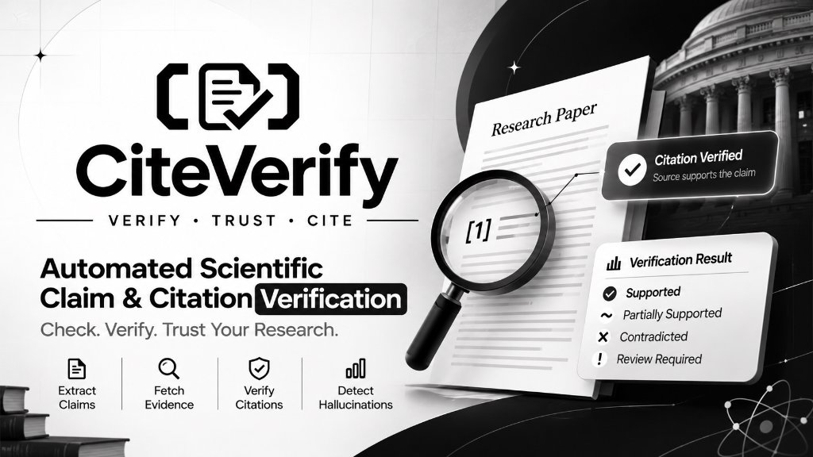
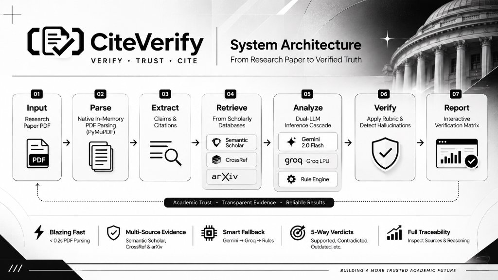

<div align="center">
  
</div>

# CiteVerify: Scientific Claim and Citation Verification System

> **VERIFY &bull; TRUST &bull; CITE**  
> **Automated verification of scientific claims, citation grounding, and reference validity in academic documents.**

[](https://fastapi.tiangolo.com)
[-4285F4.svg)](https://aistudio.google.com)
[](https://groq.com)
[-2BA44E.svg)](https://pymupdf.readthedocs.io)
[](https://vercel.com)

---

## 1. Overview

CiteVerify is an automated research technology platform designed to evaluate the factual integrity of citations in academic papers, student reports, and scientific manuscripts. The system parses uploaded document fulltext, identifies citation contexts, maps in-text references to bibliographic records, retrieves primary evidence passages from global scholarly databases (Semantic Scholar, CrossRef, arXiv), and determines whether cited literature genuinely substantiates the author's claims.

CiteVerify complies with the **INNOVEDGE Hackathon 2026 (Problem Statement 03: Scientific Claim & Citation Verification System)** specification.

---

## 2. System Architecture

<div align="center">
  
</div>

The 7-stage verification workflow operates end-to-end:
1. **01 / Input**: Ingests scientific research paper PDF.
2. **02 / Parse**: Native in-memory PDF parsing via PyMuPDF (`< 0.2s`, zero-Docker, highly portable).
3. **03 / Extract**: Isolates scientific assertions, quantitative claims, and citation markers.
4. **04 / Retrieve**: Fetches primary literature abstracts from Semantic Scholar, CrossRef, and arXiv APIs.
5. **05 / Analyze**: Dual-LLM Inference Cascade (Google Gemini 2.0 Flash primary with 1M TPM, Groq LPU fallback, and symbolic rule engine).
6. **06 / Verify**: Applies the 5-way verdict rubric, checks metadata consistency, and detects phantom citations.
7. **07 / Report**: Generates an interactive verification matrix with verbatim evidence passages, direct source links, and CSV export.

---

## 3. Core Capabilities

### 3.1 Document & Claim Extraction
Parses PDF documents to extract sentences containing empirical assertions, experimental findings, quantitative figures (e.g., percentages, metrics), and scientific conclusions that require literature support.

### 3.2 Citation Mapping
Identifies in-text citations such as `[1]`, `[Smith et al., 2021]`, and maps them to the corresponding bibliography entries, extracting author lists, publication year, title, and DOI.

### 3.3 Original Paper Retrieval
Queries scholarly graph APIs to retrieve original publication abstracts and metadata:
- **Semantic Scholar API**: High-accuracy paper graph lookup.
- **CrossRef REST API**: Authoritative DOI resolution and bibliographic verification.
- **arXiv API**: Direct preprint retrieval for cutting-edge ML and physics research.

### 3.4 Passage Ranking & Semantic Grounding
Segments retrieved source text into context-preserving sliding passages and computes cosine similarity against the extracted claim using TF-IDF vectorization.

### 3.5 Dual-Engine Stance Classification Cascade
- **Primary: Google Gemini 2.0 Flash**: Structured semantic reasoning via the official Google GenAI SDK.
- **Fallback: Groq LPU (`openai/gpt-oss-20b` / `qwen/qwen3.8-27b`)**: High-throughput inference fallback when primary limits or latency occurs.
- **Symbolic Fallback Engine**: Deterministic polarity conflict analysis, numeric discrepancy detection, and temporal drift thresholds (flags claims referencing outdated literature > 8–15 years old for modern assertions).

### 3.6 Reference Integrity Audit
Detects fabricated and hallucinated citations:
- **Non-Existent Reference**: Citations absent from academic indexes (AI citation hallucination detection).
- **Metadata Mismatch**: Discrepancies between cited author names/years and database records.
- **Misleading Citation**: Cited evidence that directly refutes or contradicts the assertion.
- **Outdated Reference**: Citations that have been superseded by subsequent literature.

---

## 4. Verification Matrix Classifications

| Classification | Meaning | Academic Trust Flag |
| :--- | :--- | :--- |
| **Supported** | Cited evidence explicitly substantiates the claim. | `[✓] Verified` |
| **Partially supported** | General topic discussed, but specific metrics or scope lack full support. | `[~] Review Required` |
| **Contradicted** | Cited evidence refutes or demonstrates opposite findings. | `[✕] Contradicted` |
| **Potentially outdated** | Cited paper is historically valid but outdated for contemporary claims. | `[◷] Outdated` |
| **Unsupported** | Cited text does not contain relevant findings addressing the claim. | `[!] Review Required` |

---

## 5. Technology Stack

- **Backend API**: FastAPI (ASGI), Uvicorn, Python 3.11+
- **Frontend Interface**: Minimalist Swiss Editorial Layout, Modular CSS (`static/css/styles.css`), Vanilla JS (`static/js/app.js`), Zero inline bloat
- **Cloud Deployment**: Vercel Serverless (`vercel.json`, `@vercel/python`), zero server retention
- **Inference Engine**: Google Gemini 2.0 Flash (`google-genai` official SDK), Groq LPU (`groq`), Scikit-Learn (TF-IDF Cosine Grounding)
- **Data & Parsing**: PyMuPDF (`fitz`), LXML, Pandas, Requests, Python-Dotenv

---

## 6. Local Quickstart

### Prerequisites
- Python 3.10+
- Git

### Installation

```bash
# Clone the repository
git clone https://github.com/meghanakumar1985-stack/CiteVerify.git
cd CiteVerify

# Switch to the beta branch
git checkout beta

# Create and activate virtual environment
python -m venv .venv
# On Windows:
.venv\Scripts\activate
# On Linux/macOS:
source .venv/bin/activate

# Install dependencies
pip install -r requirements.txt
```

### Environment Configuration (Optional)
Copy `.env.example` to `.env`:

```bash
cp .env.example .env
```

Set optional environment keys for AI-powered verification (the system falls back gracefully to deterministic symbolic verification if omitted):
```text
GEMINI_API_KEY=your_gemini_api_key_here
GROQ_API_KEY=your_groq_api_key_here
PORT=8080
```

---

## 7. Running the Application

```bash
python main.py
```
Open your browser at **`http://localhost:8080`**.
- Interactive Web App: `http://localhost:8080`
- Interactive OpenAPI / Swagger Documentation: `http://localhost:8080/docs`
- Health Status Endpoint: `http://localhost:8080/api/health`

---

## 8. Deployment to Vercel (Branch: `beta`)

CiteVerify includes a preconfigured `vercel.json` optimized for serverless Python execution on Vercel.

### Deploying the `beta` Branch:
1. In your **Vercel Dashboard**, open the **CiteVerify** project.
2. Go to **Settings** &rarr; **Git**.
3. Under **Production Branch**, set the branch to **`beta`** (or simply create a deployment from the `beta` branch).
4. (Optional) Add your `GEMINI_API_KEY` and `GROQ_API_KEY` under **Settings** &rarr; **Environment Variables**.
5. Trigger a deployment. Vercel automatically builds `api/index.py` via `@vercel/python` and serves static files from `/static`.

---

## 9. CLI Standalone Test

Execute an automated test of the verification pipeline using Python:

```bash
python -c "
from pipeline import run_pipeline
df, diag = run_pipeline(b'%PDF-demo', use_stub=True)
print(df[['Claim', 'Citation', 'Verdict', 'Confidence', 'Review Status', 'Flag', 'Source Link']].to_string())
"
```

---

## 10. Academic Trust Directive

A citation is not proof by itself. CiteVerify provides evidence excerpts, confidence ratings, and source traces to augment human review. The platform does not generate final academic judgments; all findings remain open for manual researcher and peer reviewer validation.
